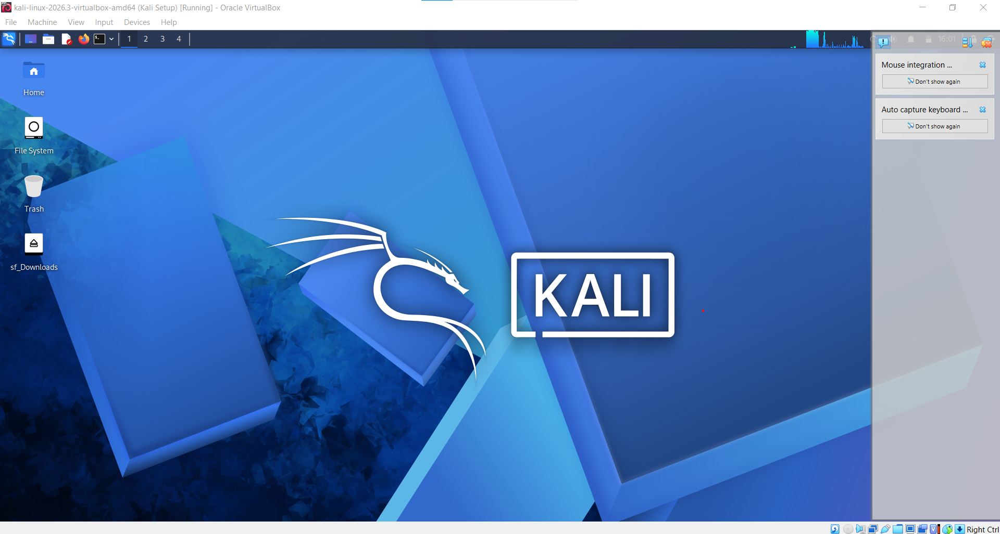
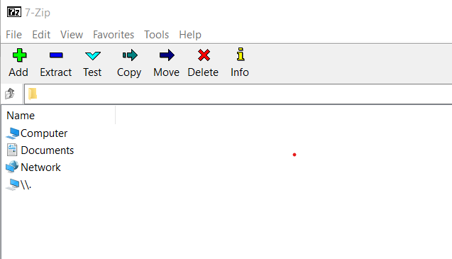
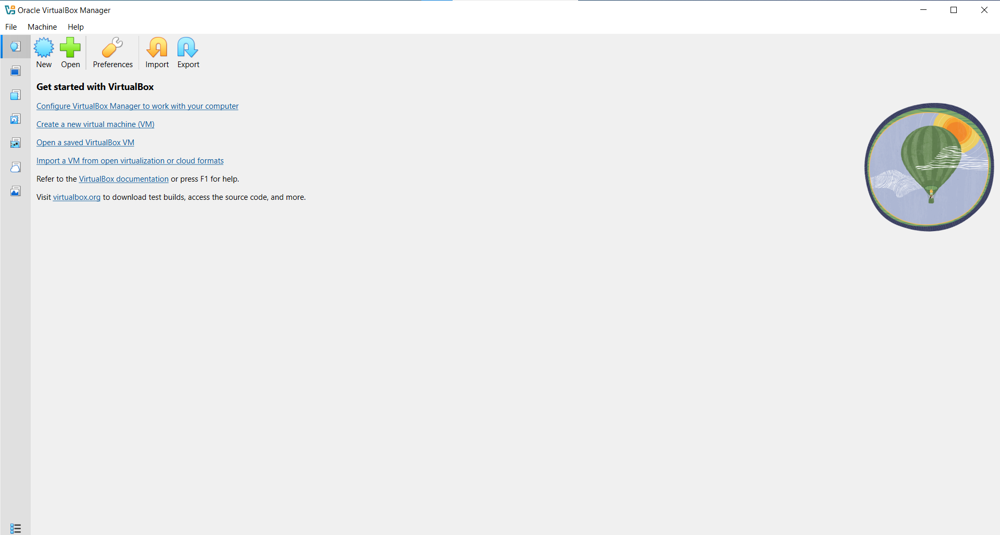
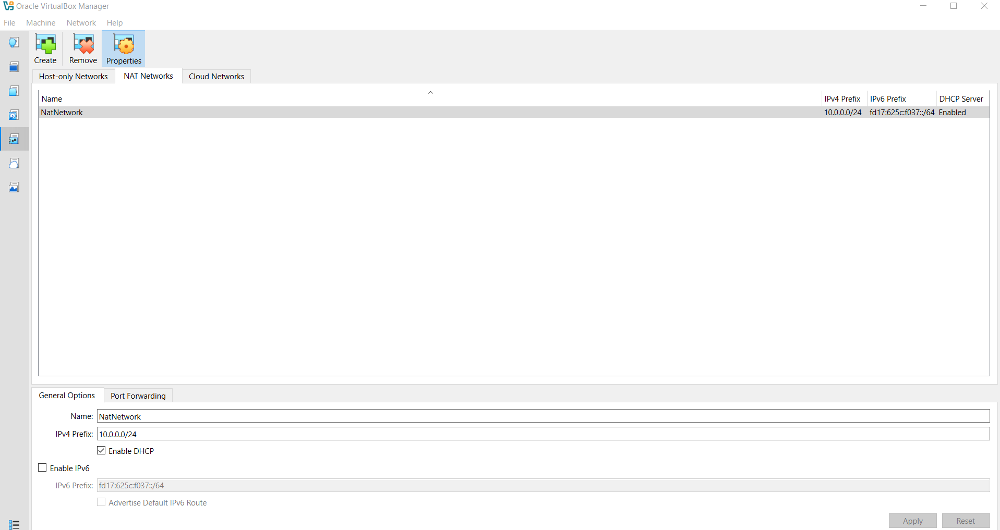
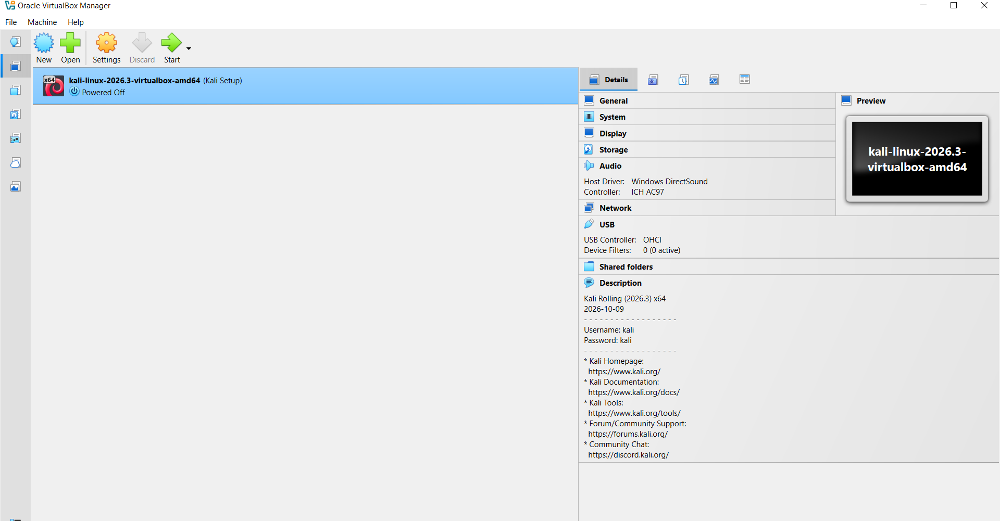
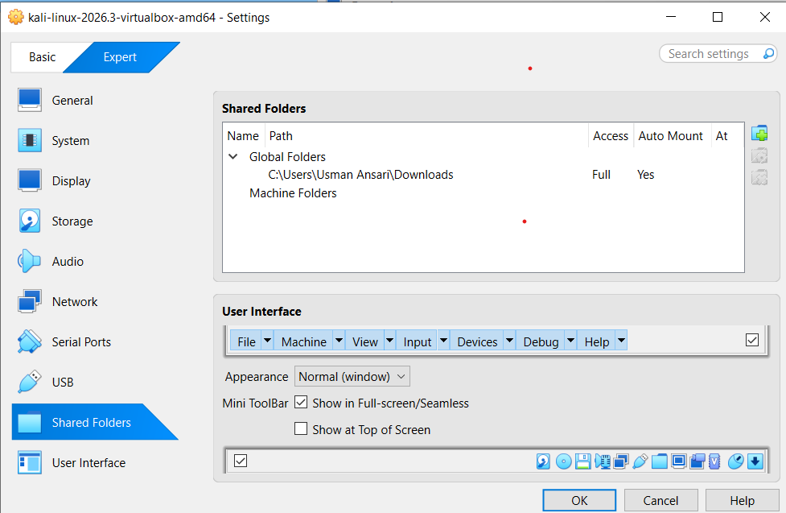

<div align="center">

# Cybersecurity Lab Environment Setup

**Building an isolated virtual lab for penetration testing and ethical hacking practice**
</div>

<p align="center">
  
  
  
  
  
  
  
  
  
  
  
</p>

---

## Project Overview

This project focuses on setting up a **virtual cybersecurity and penetration-testing laboratory** using VirtualBox and Kali Linux.

The purpose of the lab is to create a controlled environment where cybersecurity tools, network scanning, reconnaissance, vulnerability assessment, and other security-testing activities can be performed safely and repeatedly.

The lab is configured on a private virtual network so that additional machines can be added later and used as targets for authorized security testing.

---

## Objectives

The main objectives of this project are to:

- Install and configure VirtualBox.
- Install/import Kali Linux as a virtual machine.
- Create a private **NAT Network** for the cybersecurity lab.
- Configure network connectivity for Kali Linux.
- Assign a consistent IP address to the Kali VM.
- Verify network connectivity and DNS resolution.
- Take a clean VM snapshot for recovery.
- Document the complete setup process.
- Prepare the environment for future cybersecurity projects.

---

## Purpose of the Lab

The lab provides an isolated and controlled environment for cybersecurity learning and authorized security testing.

It will be used for activities such as:

- Network reconnaissance
- Port scanning
- Vulnerability assessment
- Packet analysis
- Web security testing
- Exploitation practice
- Security-tool experimentation

**Important:** This laboratory will only be used for systems that I own or have explicit permission to test. I will not use the lab or its tools to attack unauthorized systems.

---

## Lab Architecture



Additional target machines will be added to the same virtual network in future projects.

---

## Lab Configuration

| Component         | Configuration     |
| ----------------- | ----------------- |
| Host Machine      | Dell Latitude E7270 |
| Host OS           | Windows 10 Pro    |
| Host RAM          | 8 GB              |
| Processor         | Intel Core i5     |
| Hypervisor        | VirtualBox        |
| Security OS       | Kali Linux 2026.3 |
| Kali RAM          | 2048 MB           |
| Virtual Network   | NAT Network       |
| Network Address   | 10.0.0.0/24       |
| Kali IP Address   | 10.0.0.2/24       |
| Default Gateway   | 10.0.0.1          |
| DNS Server        | 8.8.8.8           |
| Future VM Range   | 10.0.0.3–10.0.0.99|

---

# Lab Setup Procedure

## Step 1. Install 7-Zip

7-Zip was installed to extract the Kali Linux virtual-machine package, which may be distributed as a `.7z` archive.

**Tool:** 7-Zip



---

## Step 2. Install VirtualBox

VirtualBox was installed as the hypervisor.



---

## Step 3. Create the NAT Network

A dedicated NAT Network was created in VirtualBox.

Configuration:
- Network Name: `NatNetwork`
- IPv4 Prefix: `10.0.0.0/24`
- DHCP: Enabled
- IPv6: Disabled



A **NAT Network** was selected because multiple virtual machines connected to the same NAT Network can communicate with one another while also having outbound network connectivity.

---

## Step 4. Import Kali Linux

The Kali Linux virtual machine was imported into VirtualBox.



The VM network adapter was configured as follows:

```text
Adapter 1
Attached to: NAT Network
Network: NatNetwork

```
The VM was booted to the desktop screen


A shared folder was also configured for transferring required files between the host operating system and the Kali VM.



